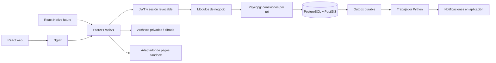

# Backend Python y portal React

Implementación local del 11 de septiembre de 2026. El plan está en [IMPLEMENTATION_PLAN.md](IMPLEMENTATION_PLAN.md); los resultados verificables, en [verification.md](verification.md).

**Actualización:** el entorno ahora se publica por HTTPS en [contrata.contupana.pro](https://contrata.contupana.pro), con `APP_ENV=staging` y pagos sandbox. Consultar [deployment.md](deployment.md) para operación, renovación, pruebas y límites actuales. Las instrucciones locales siguientes describen una instalación de desarrollo.

## Arranque reproducible

Requisitos para instalación local: Docker Compose, Python 3.12 con `venv`. Para desarrollo/pruebas web, Node 22.20 o superior compatible con Vite y npm. Las dependencias se fijan en `backend/requirements.txt` y `frontend/package-lock.json`.

```bash
cd /home/davebas/chamba
python3 scripts/dev.py setup
```

`setup` conserva secretos existentes, inicia PostgreSQL, aplica migraciones pendientes, crea cinco logins SQL restringidos, instala las herramientas Python y prepara datos ficticios una sola vez. Después construye e inicia API, trabajador y web. El propietario de la base nunca se entrega como usuario SQL de la API.

| Acceso | Dirección |
|---|---|
| Portal | http://127.0.0.1:8180 |
| API y Swagger | http://127.0.0.1:8181/api/docs |
| OpenAPI | http://127.0.0.1:8181/api/openapi.json |
| Salud | http://127.0.0.1:8181/api/health |
| PostgreSQL | `127.0.0.1:55432`, base `chamba` |

Las credenciales de los cinco usuarios ficticios están en `.local-access.md`, con permisos 0600. No se incluyen contraseñas predeterminadas en el código. `backend/.env` contiene las conexiones limitadas y claves de JWT, cifrado y webhook. `.env` es para la administración local de PostgreSQL. Los tres archivos están excluidos del repositorio.

```bash
python3 scripts/dev.py up      # aplicar nuevas migraciones e iniciar/reconstruir
python3 scripts/dev.py status
python3 scripts/dev.py stop    # detener web/API/trabajador, conservar base y datos
python3 scripts/db.py backup
```

Los puertos solo escuchan en loopback. Para acceder a este entorno desde otro computador se puede usar un túnel SSH explícito sobre 8180 y 8181. Un despliegue público necesita su dominio y HTTPS, orígenes permitidos y secretos propios.

## Arquitectura y módulos



| Carpeta | Responsabilidad |
|---|---|
| `backend/app/core` | Configuración, pools por rol, actor transaccional, JWT, errores, registro de rutas. |
| `backend/app/modules/auth` | Registro, login, renovación, logout, recuperación, verificación de correo, MFA. |
| `account` | Cuenta, contactos, direcciones, preferencias, sesiones y notificaciones. |
| `professionals` | Perfil, servicios, sedes, cobertura, horarios, credenciales, portafolio, favoritos y reseñas. |
| `requests` | Solicitudes directas/abiertas, moderación/publicación, propuestas y elección manual. |
| `contracts` | Condiciones, chat, ubicación, etapas, entregas, dinero reservado, liberación, devoluciones y pagos externos. |
| `wallet` | Créditos, planes, saldo de dinero, movimientos, cotización de retiros y métodos verificados. |
| `marketplace` | Tiendas, productos, inventario, pedidos y entrega. |
| `support`, `admin` | Tickets, mensajes públicos/notas internas, colas, permisos, KYC, planes, tasas y auditoría. |
| `files` | Carga validada, eliminación de EXIF en imágenes, almacenamiento y descarga autorizada. |
| `integrations` | Simulación de pagos, webhook firmado de pruebas y dirección de pedido cifrada. |
| `backend/app/worker.py` | Expiración, limpieza y entrega idempotente de notificaciones. |
| `frontend/src/pages` | Pantallas React separadas por dominio; carga diferida por ruta. |
| `frontend/src/api.ts` | Cliente HTTP, renovación coordinada y normalización de errores. |

Las reglas críticas permanecen en las funciones transaccionales SQL. `backend/app/operations.json` es una lista estática versionada con tipos, permisos, métodos y rutas. `scripts/export_http_registry.py` la genera durante desarrollo, nunca desde entradas del usuario ni al ejecutar una petición. Cada módulo monta únicamente sus operaciones explícitas. No hay una ruta que permita elegir el rol de conexión, ejecutar SQL o invocar una función arbitraria.

Las llamadas usan parámetros enlazados y establecen `app.user_id` y `app.correlation_id` dentro de la misma conexión/transacción. Cada respuesta incluye `X-Request-ID`; la auditoría puede relacionarse con esa petición. Errores SQL no revelan consultas, contraseñas ni detalles del servidor.

## Contrato HTTP para web y móvil

157 operaciones HTTP documentadas en [openapi.json](openapi.json) y [cobertura de rutas](route-coverage.md), incluidas 134 operaciones de negocio y las adaptaciones de autenticación, archivos, pagos y sistema. Los métodos y rutas exactos están en OpenAPI. Ejemplos:

```text
POST /api/v1/auth/register
POST /api/v1/auth/login
POST /api/v1/auth/refresh
GET  /api/v1/public/catalog
GET  /api/v1/professionals/search-professionals
POST /api/v1/requests/create-remote-request
POST /api/v1/requests/accept-proposal
GET  /api/v1/contracts/chat-messages
POST /api/v1/contracts/release-contract-funds
POST /api/v1/wallet/quote-withdrawal
```

Éxito: `{"data": ...}`. Error: `{"error":{"code":"...","message":"...","request_id":"...","details":...}}`. Las fechas son ISO 8601, los identificadores UUID y el dinero son enteros en unidades menores. La web ofrece VES (Bs) y USD (US$), ambos con factor 100; no convierte monedas. Los registros históricos conservan su moneda original. Venezuela es el único país activo; [direcciones, catálogo y búsqueda geográfica](venezuela-geolocation.md).

Los campos `key` son claves de idempotencia: un cliente móvil debe generar una UUID por intención y conservarla al reintentar **el mismo contenido**. Nunca reutilizar una clave con datos diferentes. No reintentar un retiro externo con otro identificador si se desconoce el resultado del anterior.

Web: JWT de acceso de 15 minutos en memoria; refresh de 30 días en cookie HttpOnly, SameSite Strict. La renovación rota el token; un refresh reutilizado revoca toda la familia. Renovación/logout con cookie exigen coincidencia de `chamba_csrf` y `X-CSRF-Token`. No se guarda el JWT en localStorage. Cerrar una sesión, suspender la cuenta o cambiar la contraseña invalida el acceso mediante verificación en PostgreSQL en cada petición.

React Native: enviar `client: "native"` al autenticar. La respuesta incluye `refresh_token`, que debe guardarse en Keychain/Keystore; los tokens no deben ir a AsyncStorage sin protección. La renovación nativa envía ese refresh en el cuerpo. Las demás rutas usan `Authorization: Bearer ...`. La app nativa no forma parte de esta entrega.

## Recorridos para probar el portal

**Servicio remoto:** elegir un servicio profesional, describir la necesidad, seleccionar Bs/USD y adjuntar fotos opcionales. La modalidad, categoría y título ya están definidos. Tras revisión, el cliente envía la solicitud y la profesional cotiza desde Solicitudes de clientes. El cliente confirma la propuesta para asignar el trabajo y después reserva el pago. La profesional inicia y presenta una entrega; el cliente puede pedir correcciones o validar y liberar. Ambos conservan las fotos de referencia en el contrato. Para recibir propuestas de varios profesionales, el cliente publica una necesidad abierta. [Detalle de los dos flujos](customer-requests.md).

**Servicio presencial:** registrar dirección propia con estado, municipio, parroquia y marcador; el profesional configura servicio, sede y cobertura. Elegir categoría/dirección o usar la ubicación del navegador para buscar por cercanía. Tras contratar, el cliente comparte su ubicación desde el chat; el profesional comparte su trayecto voluntariamente y marca camino, llegada e inicio. El mapa muestra origen/destino mediante Mapbox y ofrece abrir la ruta en un navegador de mapas. No se calcula ETA ni navegación giro a giro dentro de Chamba.

**Retiro:** abrir verificación, cargar documentos con finalidad KYC y adjuntarlos al expediente. Un administrador distinto revisa y aprueba con fecha de vigencia. En wallet, añadir un destino ficticio, cotizar retiro parcial o total y revisar bruto/comisión/neto. Administración puede simular el resultado pagado. Solo en esa confirmación se registra la comisión.

**Marketplace:** el profesional compra un plan de prueba con marketplace, activa la tienda y carga productos. Un pedido reserva inventario; cancelar lo restituye. El comprador comparte los datos de entrega una vez aceptado, reporta su pago externo y la contraparte confirma. No hay comisión de venta.

**Soporte:** el usuario abre caso y conversa con soporte. Las notas internas no aparecen en la vista del usuario. Las devoluciones de fondos/créditos exigen expediente y motivo; no existe un editor de saldos ni de puntuaciones de reseñas.

## Archivos, correo y operaciones

Los archivos residen en `backend/data/files`, con acceso privado y nombres generados por el servidor. JPG/PNG/WEBP se decodifican y vuelven a codificar sin EXIF; se rechazan tipos falsos, imágenes de más de 20 millones de píxeles y cargas de más de 10 MB. Los PDF se aceptan como documentos de KYC/chat/evidencia y se descargan como adjuntos. Aprobar contenido sigue siendo una acción humana autorizada. No se incluye antivirus, OCR ni proveedor automático de verificación documental.

La recuperación de contraseña y verificación de correo escriben mensajes `.eml` privados en `backend/data/mail` cuando no hay SMTP. Para correo real, configurar `SMTP_HOST`, `SMTP_PORT`, `SMTP_USER`, `SMTP_PASSWORD` y `SMTP_FROM`; el transporte exige STARTTLS. En esta implementación no se enviaron correos reales. OTP por SMS/WhatsApp, notificaciones push y OAuth social quedan para sus proveedores específicos.

El trabajador entrega avisos a la bandeja interna mediante la cola durable, con leases, intentos y deduplicación. La web consulta chat/notificaciones periódicamente y pausa su refresco cuando la pestaña está oculta. Un fallo de notificación no repite contrataciones ni movimientos monetarios.

## Límite entre pruebas y operación comercial

La instalación local usa `APP_ENV=development`; el dominio publicado usa `APP_ENV=staging`. Ambos mantienen `PAYMENT_MODE=sandbox`. Hay planes ficticios en VES y USD, una comisión DEMO de 2 % y perfiles de ejemplo, identificados por el aviso general. **No son precios ni políticas comerciales aprobadas para producción.** Todas las recargas, compras y confirmaciones son simuladas.

La ruta de webhook de pruebas verifica HMAC SHA-256 de `timestamp + '.' + cuerpo`, con `X-Chamba-Timestamp` y `X-Chamba-Signature`, ventana de cinco minutos y `WEBHOOK_SECRET`. PostgreSQL verifica de nuevo importe, moneda, referencia y unicidad del evento. La firma de sandbox no sustituye la validación contra un proveedor bancario real. Los endpoints de simulación se rechazan en producción.

La siguiente etapa externa consiste en seleccionar una pasarela compatible con Venezuela y las monedas operativas, KYC, canal de correo/push y almacenamiento comercial; implementar su adaptador, reconciliación, liquidación y retiros sobre las funciones existentes y probarlo en su sandbox oficial. HTTPS y su renovación están publicados; antes de una operación comercial faltan pruebas de carga, procedimientos periódicos de respaldos/restauración, retención de archivos y gestión/rotación de claves. La custodia real de dinero no queda garantizada por una reserva contable local.

## Desarrollo y comprobaciones

```bash
# Backend, en una terminal
cd backend
.venv/bin/uvicorn app.main:app --host 127.0.0.1 --port 8181 --reload

# Web, en otra terminal
cd frontend
npm ci
npm run dev

# Pruebas y compilación desde la raíz
python3 tests/run.py
(cd backend && .venv/bin/pytest -q)
(cd frontend && npm run build)
(cd frontend && npx playwright install chromium && npx playwright test)
```

Para usar el modo de desarrollo en 8181, detener antes el contenedor API local; la web Vite escucha en 5180 y deriva `/api` a 8181. Las pruebas SQL y HTTP crean bases desechables con nombre aleatorio y las eliminan al finalizar. Las pruebas de navegador requieren el entorno sandbox y las cuentas de `.local-access.md`; crean actividad ficticia persistente en esa base demo. No deben ejecutarse contra datos comerciales.
