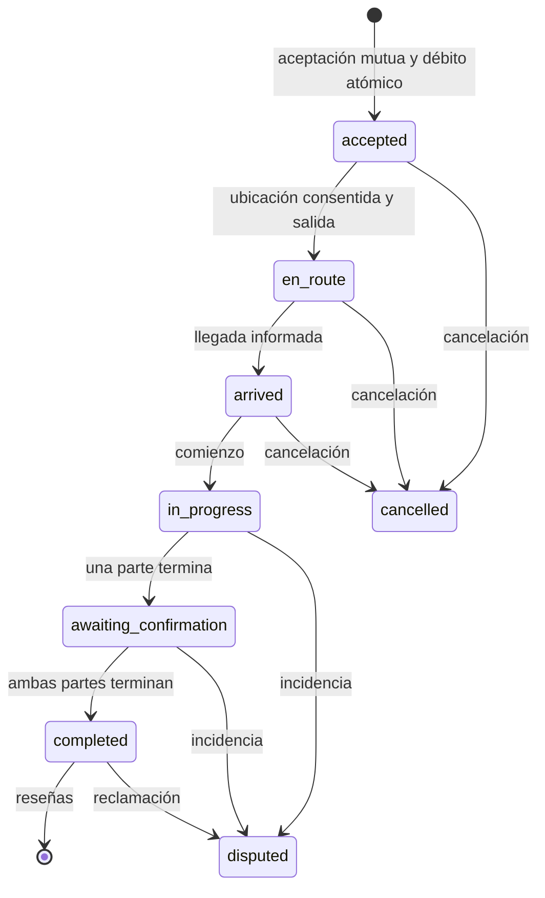

# Modelo de Chamba

## Relaciones principales

```mermaid
erDiagram
    users ||--o| professionals : activa
    users ||--o{ addresses : registra
    users ||--o{ user_contacts : mantiene
    users ||--o{ user_roles : posee
    users ||--o{ sessions : autentica
    users ||--o{ kyc_cases : verifica
    professionals ||--o{ branches : tiene
    professionals ||--o{ offerings : ofrece
    branches ||--o{ coverage_areas : cubre
    categories ||--o{ offerings : clasifica
    categories ||--o{ service_requests : clasifica
    users ||--o{ service_requests : solicita
    service_requests ||--|| request_locations : conserva_privada
    service_requests ||--o{ request_attachments : adjunta
    service_requests ||--o{ proposals : recibe
    professionals ||--o{ proposals : presenta
    service_requests ||--o| contracts : adjudica
    professionals ||--o{ contracts : atiende
    contracts ||--|| conversations : abre
    conversations ||--o{ messages : contiene
    contracts ||--o{ location_shares : autoriza
    contracts ||--o{ contract_events : registra
    contracts ||--o{ reviews : permite
    professionals ||--|| credit_wallets : dispone
    credit_wallets ||--o{ credit_ledger : contabiliza
    contracts ||--o{ credit_ledger : consume_o_devuelve
    plans ||--o{ credit_purchases : origina
    credit_purchases ||--o{ payment_events : concilia
    credit_purchases ||--o{ entitlements : habilita
    credit_purchases ||--o{ credit_ledger : acredita
    professionals ||--o| stores : activa
    users ||--o{ money_wallets : mantiene_por_moneda
    money_wallets ||--o{ money_topups : recarga
    money_wallets ||--o{ money_accounts : contabiliza
    money_accounts ||--o{ money_entries : registra
    money_transactions ||--|{ money_entries : equilibra
    contracts ||--o| service_escrows : protege
    contracts ||--o{ funding_quotes : cotiza_reserva
    contracts ||--o{ service_deliveries : entrega
    users ||--o{ payout_methods : verifica_destino
    withdrawal_fee_policies ||--o{ withdrawal_quotes : fija_comision
    withdrawal_quotes ||--o| money_withdrawals : autoriza
    money_wallets ||--o{ money_withdrawals : retira
    stores ||--o{ products : vende
    users ||--o{ orders : compra
    stores ||--o{ orders : recibe
    orders ||--|{ order_items : contiene
    products ||--o{ order_items : integra
    products ||--o{ inventory_movements : registra
    orders ||--o| order_delivery : comparte
    contracts ||--o{ support_tickets : requiere_soporte
    orders ||--o{ support_tickets : requiere_soporte
    outbox ||--o{ notification_deliveries : intenta
```

El diagrama resume las relaciones comerciales. El SQL incluye más tablas auxiliares y restricciones; el [diccionario](data-dictionary.md) es la referencia exacta del esquema.

## Organización

| Grupo | Tablas |
|---|---|
| Identidad y acceso | `users`, `credentials`, `auth_identities`, `sessions`, `auth_challenges`, `roles`, `permissions`, `role_permissions`, `user_roles` |
| Contacto y consentimiento | `user_contacts`, `addresses`, `legal_documents`, `user_consents` |
| Profesionales | `professionals`, `branches`, `professional_contacts`, `branch_hours`, `offerings`, `coverage_areas`, `portfolio_items`, `professional_credentials`, `favorites` |
| Categorías y archivos | `categories`, `files`, `request_attachments`, `product_images`, `kyc_documents` |
| KYC | `kyc_cases`, `kyc_documents` |
| Contratación | `service_requests`, `request_locations`, `proposals`, `contracts`, `contract_terms`, `contract_events` |
| Comunicación | `conversations`, `messages`, `message_receipts`, `location_shares`, `professional_positions` |
| Reputación | `reviews`, `moderation_actions` |
| Monetización | `credit_wallets`, `credit_ledger`, `plans`, `credit_purchases`, `payment_events`, `entitlements` |
| Dinero y retiros | `money_wallets`, `money_accounts`, `money_transactions`, `money_entries`, `money_topups`, `payout_methods`, `withdrawal_fee_policies`, `withdrawal_quotes`, `money_withdrawals`, `money_provider_events`, `provider_payment_registry`, `money_incidents` |
| Servicio protegido | `funding_quotes`, `service_escrows`, `service_deliveries`, `delivery_files` |
| Marketplace | `stores`, `products`, `product_images`, `orders`, `order_items`, `order_delivery`, `order_events`, `inventory_movements` |
| Pagos entre usuarios | `external_payment_reports` |
| Administración | `support_tickets`, `support_messages`, `audit_events` |
| Notificaciones | `outbox`, `notification_deliveries`, `device_tokens`, `notification_preferences` |

## Estados del servicio

Este recorrido corresponde al servicio presencial. En remoto se pasa de `accepted` a `in_progress` después de reservar los fondos, sin salida ni llegada. En todo contrato protegido, `submit_delivery` conduce a `awaiting_confirmation` y únicamente `release_contract_funds`, ejecutada por el cliente, completa el contrato y acredita al profesional.

El registro de llegada es una declaración del profesional. La base no demuestra por sí sola presencia física ni verifica GPS. Una visita puede incluir varias tareas descritas en la solicitud, pero tiene una categoría principal de búsqueda; varios servicios independientes se modelan con solicitudes diferentes.

## Decisiones de integridad

- Una solicitud mantiene una copia de la dirección; modificar posteriormente la libreta del cliente no cambia el destino contratado.
- El profesional puede tener varias sedes. La elegibilidad exige al menos una sede activa con categoría y radio compatibles; un polígono opcional limita adicionalmente esa cobertura. La distancia es geográfica en línea recta, no tiempo de conducción.
- `credit_wallets.balance` se actualiza junto con el movimiento de `credit_ledger` dentro del mismo bloqueo. Se conserva `balance_after` y referencias al contrato/compra/reversión. No se borra un movimiento para corregirlo: se registra otro.
- Los mensajes se identifican también por `client_message_id`, que la app debe conservar al reintentar. Las claves de idempotencia de solicitudes, compras y pedidos también se generan una vez y se reutilizan.
- Cada solicitud tiene como máximo un contrato. Para volver a buscar tras cancelación, crear otra solicitud; no reemplazar silenciosamente al profesional de un contrato histórico.
- El dinero usa contabilidad de doble partida por moneda, con suma cero por transacción y saldos no negativos para usuarios/reservas. El disponible de una wallet excluye lo reservado para contratos y retiros. Este dinero no se convierte automáticamente en créditos de contratación.
- Cada servicio remoto exige pago protegido; los presenciales también pueden usarlo. La modalidad y protección quedan fijas al crear el contrato. La preferencia del perfil no altera contratos anteriores.
- Las cotizaciones de retiro fijan tasa, comisión e importe neto por 15 minutos. El profesional recibe el precio completo al liberarse el servicio; la comisión solo aparece si un usuario retira dinero y el proveedor confirma el retiro.
- Los pedidos toman precio, nombre y SKU del producto en el servidor. Un carrito de varias tiendas genera un pedido por tienda. No hay variantes, cupones, logística ni devoluciones monetarias automáticas en esta primera base.
- KYC y posicionamiento son conceptos separados. La reseña publicada de un cliente no muestra su identificador, nombre ni contrato al consultar el perfil público.
- El cierre, la suspensión y el archivo se modelan como estados. Las claves foráneas evitan eliminar accidentalmente usuarios con actividad histórica.
