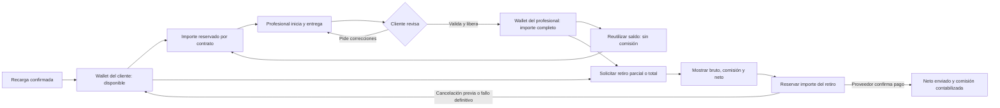

# Servicios remotos, pagos protegidos y wallet

La regla comercial confirmada es: **se cobra comisión únicamente al retirar dinero**. No se cobra por recargar, conservar saldo, reservar un servicio, pagar desde la wallet ni liberar el pago al profesional. Los créditos para aceptar solicitudes siguen siendo una unidad independiente del dinero.

## Cómo funciona

La devolución de un retiro fallido/cancelado vuelve a la wallet de su solicitante, sea cliente o profesional. La flecha de retorno al cliente en el diagrama representa esa misma cuenta de origen, no una transferencia entre usuarios.

## Modalidades y preferencias

- `offerings.delivery_mode`: `onsite` o `remote`. `api.add_offering` conserva el comportamiento presencial existente; `api.set_offering_delivery` permite al propietario marcar el servicio remoto. Para ofrecer ambas modalidades, crear dos servicios, cada uno con su precio y modalidad.
- `api.create_remote_request`: solicitud directa o abierta con descripción de requisitos y precio ofrecido. No genera dirección ni coordenadas. `api.search_remote_professionals` busca por categoría, precio/moneda y reputación, sin exigir proximidad.
- `api.set_payment_preference(true)`: la cuenta indica que requiere pagos dentro de la plataforma. La preferencia corresponde al usuario, tanto cuando contrata como cuando ofrece servicios; puede consultarla con `api.payment_preferences`.
- `api.protect_service_request`: el cliente puede exigir pago protegido para un presencial antes de publicarlo.
- Al contratar, el servicio es protegido si es remoto, si lo exige la solicitud o si lo exige cualquiera de las partes. El resultado se conserva en el contrato; cambiar luego el perfil no elimina la protección.
- El distintivo de preferencia del perfil no afirma que un trabajo tenga fondos. La interfaz debe usar `funds_guaranteed` de `api.escrow_details`: solo es verdadero con una reserva financiada y sin incidencias que congelen el origen. `funding_on_hold` indica disputa o congelación; no inferir garantía solamente del campo `status`.

## Fondos confirmados y reserva

1. Cliente y profesional aceptan el contrato por cualquiera de las dos modalidades de adjudicación ya existentes. Se abre el chat y se cobra el crédito de contratación conforme al modelo original.
2. En una solicitud directa remota, aceptar incluye el importe ofrecido por el cliente. En una publicación abierta, el precio es el de la propuesta elegida. Un presencial protegido sin precio necesita acordarlo mediante condiciones aceptadas por ambos; usar `payment_method='platform_wallet'`.
3. `api.create_topup(moneda, importe, clave)` registra una intención de recarga. Esto **no incrementa saldo**.
4. El servicio de pagos valida con el proveedor el titular/pedido, comercio, firma, moneda, importe y estado liquidado. Solo entonces llama a `api.confirm_topup`; se acredita exactamente el importe de la recarga, sin descontar comisión.
5. El cliente llama a `api.quote_contract_funding` y ve importe, moneda, requisitos y comisión cero. La cotización dura 15 minutos y guarda una copia de las condiciones.
6. Al confirmar, `api.fund_contract(cotizacion, clave)` mueve el importe del disponible a una cuenta reservada para ese contrato. El saldo reservado ya no se puede gastar ni retirar.
7. La operación de inicio rechaza un contrato protegido que no esté financiado. En presencial también se bloquea iniciar el desplazamiento antes de la reserva. Los cambios de precio/condiciones posteriores a financiar se rechazan.

No hay cambio de moneda automático. Hay una wallet por usuario y moneda; una recarga en una moneda no financia un servicio en otra. Las cuentas de clientes y profesionales pueden conservar y reutilizar dinero para contratar otros servicios protegidos.

## Entregables, correcciones y liberación

`api.submit_delivery` registra versión, descripción, requisitos acordados y archivos. Solo acepta archivos del profesional que hayan sido revisados y procesados. El cliente puede leerlos por el mismo control de acceso privado que el resto de archivos del contrato.

`api.request_delivery_changes` registra lo que falta y permite otra versión sin devolver ni liberar los fondos. El cliente no puede liberar una versión superada. `api.release_contract_funds` exige al cliente autenticado, la entrega vigente, reserva financiada y ausencia de disputa/congelación; acredita **todo el precio** a la wallet del profesional y completa el contrato. La operación es idempotente y se registra en el libro de dinero y en los eventos del contrato.

No hay liberación automática por plazo, cierre unilateral del profesional o botón genérico `finish`. Soporte tampoco dispone de una función para pagar al profesional sin la validación del cliente. Si el cliente deja de responder, los fondos permanecen reservados y se necesita una política de mediación adicional antes de automatizar otro desenlace.

Esta versión tiene una reserva y una liberación total por contrato. Hay versiones de entrega, pero no hitos con pagos parciales. Los retiros de wallet sí pueden ser parciales o totales.

## Retiros y comisión configurable

La comisión se aplica a cualquier usuario que retire: tanto clientes que recuperan saldo precargado como profesionales que retiran sus ingresos. Se descuenta del importe que solicita retirar; no se añade como otro débito oculto.

Ejemplo ilustrativo con tasa del 2 %:

| Operación | Importe |
|---|---:|
| Saldo antes del retiro | 100,00 |
| Importe solicitado | 40,00 |
| Comisión de retiro | 0,80 |
| Neto a recibir | 39,20 |
| Saldo que queda disponible | 60,00 |

La semilla del entorno local activa 2 % en COP únicamente como tarifa DEMO; no es una política comercial de producción. Administración debe configurarla por moneda con `api.configure_withdrawal_fee`; admite 0 %. Se expresa en puntos básicos: 100 = 1 %, 200 = 2 %. El cálculo usa enteros/decimales exactos y redondea la comisión hacia arriba a la unidad monetaria menor; si no deja un neto positivo, se rechaza el importe por ser demasiado pequeño.

1. Usuario registra un destino tokenizado con `api.add_payout_method`; se guarda el identificador del proveedor y una descripción enmascarada, no credenciales bancarias en texto libre.
2. El servicio de pagos comprueba titularidad y habilitación en el proveedor y llama a `api.verify_payout_method`. El usuario también debe tener KYC vigente para retirar.
3. `api.quote_withdrawal(moneda, metodo, importe)` muestra bruto, tasa, comisión y neto. `importe=NULL` cotiza todo el disponible, excluyendo reservas.
4. `api.request_withdrawal(cotizacion, clave)` reserva el bruto. Una modificación posterior de la tasa administrativa no cambia esa cotización durante sus 15 minutos de validez.
5. El trabajador llama a `api.prepare_withdrawal` y recibe el destino fijado, neto y una clave de idempotencia estable `withdrawal:<UUID>`. Debe confirmar esta transacción SQL **antes** de intentar el envío externo.
6. El envío real usa esa misma clave en el proveedor. Una confirmación verificada se procesa con `api.confirm_withdrawal` y resultado `paid`.
7. Solo ese resultado debita la reserva del retiro y reconoce la comisión. Cancelar antes de enviarlo o recibir un fallo **definitivo verificado** devuelve el bruto íntegro a la wallet, sin comisión.

Un timeout, una desconexión o un resultado desconocido no se tratan como rechazo del retiro. El importe sigue reservado. Consultar al proveedor y reconciliar la misma operación; no crear otro envío ni devolver el dinero mientras pueda haberse pagado. Una wallet congelada impide preparar otro envío, aunque ya hubiera un intento iniciado. Las confirmaciones de pagos ya enviados se concilian con su estado real.

La protección de SQL impide duplicar el movimiento local. Evitar duplicar un pago bancario depende además de que el adaptador/proveedor respete la clave estable, verifique las respuestas y nunca interprete un timeout como fallo definitivo. No se ha conectado un proveedor en esta entrega.

## Devoluciones, incidencias y mediación

- El cliente no puede cancelar un contrato financiado y retirar por su cuenta su reserva.
- `api.request_escrow_refund` crea una disputa y solicita devolver los fondos; `api.approve_escrow_refund` permite al profesional aprobarla. El importe completo vuelve a la wallet del cliente, sin comisión.
- `api.resolve_escrow_refund` permite a administración resolver una devolución con contrato en disputa, ticket relacionado y motivo auditado. No permite convertir una disputa en un pago al profesional sin autorización del cliente.
- La devolución de dinero y la devolución del crédito comercial son operaciones diferentes.
- `api.flag_money_incident` registra un problema de proveedor, como un contracargo, y congela la wallet. No inventa una reversión bancaria ni crea saldo negativo disponible. Bloquea nuevos egresos hasta una conciliación controlada.
- La resolución de contracargos, saldos en revisión, pagos ya retirados y descongelaciones necesita la política de tesorería y el adaptador del proveedor. No existe un botón genérico de administrador para modificar saldos o descongelarlos ignorando esa conciliación.

## Contabilidad y permisos

`money_transactions` y `money_entries` son de solo anexado. Cada transacción debe tener al menos dos entradas, una única moneda y suma cero, comprobado al confirmar la transacción. Los saldos de usuarios y reservas no pueden ser negativos. `money_accounts` distingue:

| Tipo de cuenta | Significado |
|---|---|
| `available` | Saldo utilizable y retirable de un usuario. |
| `contract_hold` | Dinero reservado por un contrato y su cliente. |
| `withdrawal_hold` | Importe bruto reservado para un retiro específico. |
| `cash_clearing` | Contrapartida contable de cobros/envíos externos; no es una consulta del saldo bancario. |
| `platform_fees` | Comisiones de retiros confirmados. |

`provider_payment_registry` impide usar el mismo pago externo para acreditar a la vez créditos comerciales y dinero de wallet. Los eventos de recarga/retiro verifican identificador, finalidad, referencia, importe, moneda y huella del evento antes de tratar un reintento como equivalente.

`chamba_api` no puede confirmar recargas, validar destinos, despachar retiros ni registrar resultados del banco. Esas funciones son exclusivas de `chamba_billing`. La configuración de comisión y la resolución de devoluciones requieren el rol de conexión administrativo y permisos del usuario de aplicación. Las tablas no se exponen a estos roles.

El backend debe tratar las transacciones monetarias con `COMMIT` antes de afirmar éxito o invocar una acción externa. Al usar `app.user_id`, conservar la frontera de confianza descrita en [integración](integration.md).

## Conexión a dinero real

Están implementados la base, el control contable, la API HTTP, el portal React y un adaptador sandbox con webhook HMAC para pruebas. Para ofrecer una garantía real se necesita un proveedor que admita los países, monedas, cobros, reservas/transferencias, verificación y retiros del producto. La firma del webhook, la liquidación real, los importes netos del proveedor, su conciliación y las obligaciones de custodia dependen de esa integración y del país; no se activaron cuentas financieras ni se movió dinero real.

Los costos del proveedor en recargas se gestionan como costo de la plataforma, porque el cliente debe recibir íntegro lo recargado. El operador debe conciliar esos costos, comisiones de retiro, contracargos y saldo externo disponible; el valor de `cash_clearing` no demuestra por sí solo que haya fondos líquidos en un banco.

Como referencia técnica, la documentación de [cobros y transferencias separados](https://docs.stripe.com/connect/separate-charges-and-transfers) distingue el cargo al cliente de la transferencia al profesional; su [documentación de saldos](https://docs.stripe.com/connect/account-balances) explica la relación con los pagos hacia cuentas externas. Son referencias de integración, no una selección de proveedor ni una afirmación de disponibilidad para el país de lanzamiento.
